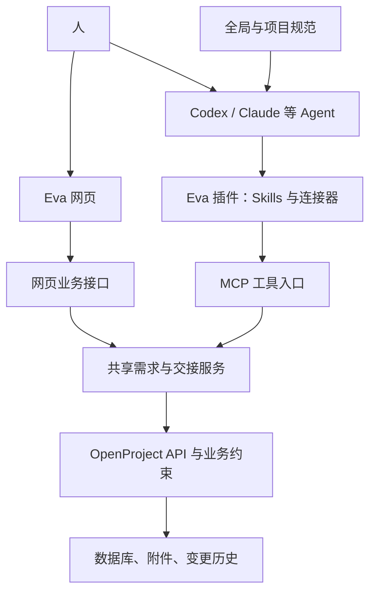

# Eva Project 用户功能手册

版本：2026-11-04。依据本仓库当前代码、插件 0.1.5 的工具合同和业务规则整理。

本轮界面修复已合入工作区源码，详见 [修复与验证记录](eva-ui-fixes-2026-11-04.md)。需要同步更新网页和 MCP 服务后才可完整使用新增入口；本文描述源码中的最终功能，不把未更新的运行实例视为已验收。

本文面向第一次使用 Eva 的用户，说明系统用途、各项功能和日常操作。页面问题与改进计划见同目录《Eva 功能与 UI 评审报告》。本文不代表所有功能都已在真实账号下完成验收。

## 1. Eva 是做什么的

Eva 是人和 Agent 共用的项目需求与上下文交接系统。

它帮助团队把“要做什么、为什么这样做、谁正在做、做到哪里、如何验证、下一次怎么接着做”保存下来。Codex、Claude 等 Agent 负责理解与执行，Eva 保存可共享、可查询、可追溯的工作记录。

典型场景：你让 Agent 开发登录功能，先登记需求并约定验收条件；Agent 认领并修改代码，记录验证结果；今天做不完，就保存交接；明天打开代码仓库，新会话读取交接和最新需求后继续。

适用人群：提出需求和验收的人、执行任务的开发者与 Agent、协调分工的项目负责人、维护账号和备份的管理员。

当前系统不会因为接入成功就持续在后台开发，也不会自动保存全部聊天或扫描全部代码。实际执行与记录范围取决于用户指令、项目约定和账号权限。

## 2. 先认识这几个概念

| 名称 | 含义 | 例子 |
| --- | --- | --- |
| Eva 项目 | 一组需求、交接和访问权限的归属范围 | Agent 接入测试 |
| 本地代码仓库 | Agent 实际读取代码、修改文件和运行测试的位置 | 你在 Codex 中打开的开发目录 |
| 连接账号 | 让 Agent 通过你在 Eva 中已有的权限访问服务 | 一鸣的 Codex 连接 |
| 绑定仓库 | 在项目规范中确认这个代码仓库默认使用哪个 Eva 项目 | 记录 Eva project_id 与 Eva identifier |
| 需求 | 长期保存的目标、范围、验收和完成状态 | 登录失败时显示明确错误提示 |
| 子任务 | 对一个大需求的分工，每条可以独立认领和验证 | 页面、接口、测试分别处理 |
| 依赖 | 表示执行顺序，与父子归属分别管理 | 页面联调被接口任务阻塞 |
| 交接 | 某次工作停下时留下的进度、决策和下一步 | 今天已写接口，明天补测试 |
| 工作线 | 持续围绕同一任务推进的一条上下文链 | 某条需求的历次会话交接 |
| 认领 | 记录实际执行的 Agent 与会话 | Codex 的本次会话负责接口 |
| 证据 | 支持交付判断的提交、文件位置、验证结果及验收来源 | 提交 SHA、测试结果、人工确认 |

连接账号与绑定仓库是两步。未绑定时，可以明确指定 Eva 项目查询或写入；绑定后，按项目约定触发协作流程。

M-Project 与 Eva 是不同系统，数据不会因连接或绑定自动迁移。本次检查所在仓库仍使用 M-Project；用户明确指定的 Eva 测试操作不改变这一默认选择。

## 3. 功能总览

“Agent”表示可在 Codex 等已接入客户端中通过自然语言调用；“网页”表示本仓库自建页面提供入口；“原生入口”表示需要转到 OpenProject 工作包、成员或设置页面，并受相应权限限制。

### 3.1 首页与项目概览

| 功能 | 有什么用 | 使用入口与边界 |
| --- | --- | --- |
| 全部项目 / 单项目概览 | 看团队整体或某个项目的工作量 | 首页，按本人可访问范围统计 |
| 日、周、月及历史时间段 | 对比某段时间新提出的工作 | 首页时间选择器 |
| 当前状态统计 | 看当前未认领、进行中、待验收、已完成等数量 | 首页“现状”，不受上方时间段影响 |
| 新建与完成趋势 | 看需求进入和完成情况的变化 | 首页图表，可切换表格；统计口径见页面说明 |
| 状态、模块、负责 Agent 分布 | 了解工作在哪些领域、如何分工 | 首页分布图与统计表 |
| 等待确认、等待验收、停滞事项 | 找到需要人关注的工作 | 首页关注列表 |
| 待接手交接与最近更新 | 快速找到接续工作和近期变化 | 首页列表；精确定位仍有可改进处 |

### 3.2 需求管理

| 功能 | 有什么用 | 使用入口与边界 |
| --- | --- | --- |
| 查看项目需求 | 看该项目可访问的需求清单 | 需求池、Agent |
| 分类 | 区分任务、功能和缺陷 | 网页新建、Agent；使用目标项目实际启用类型 |
| 筛选、分页与层级展开 | 从较多记录中找目标，展开父子任务 | 需求池；可按状态、类型、Agent 等筛选 |
| 默认隐藏已完成 | 日常优先关注待处理工作 | 需求池；通过状态筛选查看已完成项 |
| 创建需求 | 保存标题、用户原话、验收条件等 | 网页可手工创建，Agent 可保存更完整的理解、范围和来源 |
| 读取完整需求 | 理解目标、范围、来源和验收 | 详情侧栏、Agent；Agent 支持按章节读取 |
| 调整需求内容 | 在原始意图基础上维护范围与理解 | 详情“编辑需求”、Agent；保留用户原文，以打开时的版本保存 |
| 拆分分工子任务 | 把大任务分给不同执行者 | 网页“分工子任务”、Agent；批量创建最多 20 个子项 |
| 设置或调整父级 | 管理归属关系 | 详情“关系 → 维护父级与执行依赖”、Agent；同项目操作并防止层级循环 |
| 添加执行依赖 | 表达“先做 A，再做 B” | 详情“关系”、Agent；搜索并选择同项目的前置任务 |
| 认领 | 记录谁在实际处理，减少重复执行 | 网页、Agent；Agent 认领会记录实际会话 |
| 释放认领 | 暂停处理或交还任务 | 网页、Agent；需写原因，接管受权限限制 |
| 更新状态 | 表达真实进度 | 需求池状态列、Agent；Agent 推进执行状态前须认领 |
| 提交完成与验收 | 保存交付证据并核对完成条件 | 网页、Agent；人工验收和 Agent 提交证据的规则不同 |
| 重新打开 | 完成后发现问题时恢复处理 | 网页、Agent；填写原因并保留旧证据与历史 |
| 评论与变更历史 | 保存讨论、决策和调整理由 | 需求详情“历史”、Agent |
| 上传参考附件 | 保存图片、PDF、Office 文档等资料 | 详情“附件 → 上传附件”、Agent；单个附件最多 20 MiB |
| 查看或下载附件 | 获取需求的参考材料与交付文件 | 详情“附件”；访问受权限限制 |
| 按需读取 Markdown | 不必一次把所有资料塞入会话 | Agent；通用附件上传不等于所有格式都支持自动正文解析 |

### 3.3 上下文交接

| 功能 | 有什么用 | 使用入口与边界 |
| --- | --- | --- |
| 查看待接手、已接手和全部交接 | 找到停止的工作和负责接续的人 | 上下文交接页面、Agent；页面可搜索并加载更多 |
| 保存交接 | 记录背景、主线、现状、待办、注意事项 | 网页可手写；建议由实际工作的 Agent 根据事实整理 |
| 记录代码基线与环境 | 知道在哪个仓库、分支和提交上停止 | Agent 交接保存；当前网页新建表单不会自动采集代码环境 |
| 关联需求 | 让交接待办指向实际需求 | 网页逐项搜索选择需求，Agent 结构化保存；不需要记编号 |
| 待办勾选和进度计数 | 区分已完成步骤与剩余步骤 | 网页、Agent；勾选不自动完成关联需求 |
| 显示需求现状与差异 | 提醒交接内容可能落后于需求最新状态 | 读取交接时核对关联需求；无法访问的内容不会凭空补全 |
| 编辑章节与待办 | 补充事实和修正工作计划 | 网页、Agent |
| 接手与释放 | 明确哪一会话接续这份上下文 | 网页、Agent；不抢占其他活跃会话 |
| 查找某条工作线最新交接 | 无需死记交接编号即可恢复工作 | Agent；有多个候选时先列摘要确认 |
| 前后交接链与归档 | 保留工作接力历史 | 网页选择继续已有工作线、Agent；替换待接手旧记录需明确勾选确认并具备权限 |
| 跨 Agent 接续 | Codex 与 Claude 等读取同样的工作记录 | 要求客户端已连接、具备权限，并核对本地代码环境 |

### 3.4 搜索、阅读与界面辅助

| 功能 | 有什么用 | 使用入口与边界 |
| --- | --- | --- |
| 顶栏全局搜索 | 不知道编号时按内容找记录 | 搜索需求和交接；覆盖标题、编号、正文和评论 |
| 搜索预览与分组结果 | 先快速定位，再查看完整记录 | 顶栏预览、结果页；需求与交接分别分页 |
| 搜索关键词高亮 | 快速理解为什么找到这条记录 | 搜索结果与正文片段 |
| 需求关系跳转 | 从主任务跳到子任务、依赖或相关交接 | 需求详情“关系” |
| 列宽记忆 | 根据个人阅读习惯调整列表 | 桌面需求池；布局偏好保存在浏览器 |
| 项目选择记忆 | 在需求池与交接页面间保留查看范围 | 浏览器记忆选择，不改变仓库绑定 |
| 表单草稿保护 | 收工或误关闭时避免丢失长输入 | 按账号、项目、表单区分，保存在当前浏览器标签页；成功提交后清除 |
| 记录直链与复制 | 分享或刷新后继续查看同一记录 | 需求与交接详情可复制链接；接收方仍需对应权限 |
| 移动端列表与详情 | 窄屏查看任务、待办和记录 | 有卡片与返回列表适配；仍需真实手机补验 |
| 主题与加载反馈 | 适应外观偏好并显示正在加载 | 网页主题、加载提示、错误与冲突提示 |

### 3.5 Agent 接入

| 功能 | 有什么用 | 使用入口与边界 |
| --- | --- | --- |
| 安装提示词与插件包下载 | 让用户把安装任务交给自己的 Agent | Agent 接入页，支持 Codex、Claude Code 与通用方式 |
| 校验发布包 | 核对下载的插件是否与发布信息一致 | 安装说明提供 SHA-256 |
| 浏览器配对确认 | 用户在自己的浏览器确认连接 | 核对配对码，不在聊天里发送 Token |
| 连接诊断 | 看实例、当前身份和可访问项目 | doctor、eva_connection_info、requirements_projects |
| 全局与项目规范范本 | 配置何时触发和默认使用哪个项目 | Agent 接入页、包内 templates |
| 4 个 Skills | 提供连接、需求、交接和接续操作步骤 | eva-connect、eva-requirements、eva-handoff、eva-resume |
| 日常使用指令 | 安装后知道怎样查看、收工和继续 | Agent 接入页可选择有权限的项目，并复制三类指令 |
| 升级与卸载 | 更新插件并保留个人连接配置 | 按插件 README 操作；卸载不自动吊销服务端凭据 |

### 3.6 账号、权限与管理

| 功能 | 有什么用 | 使用入口与边界 |
| --- | --- | --- |
| 网页登录与个人账号 | 确认操作者身份 | 登录页和原生个人账号入口 |
| 项目成员与访问权限 | 控制哪些人可以查看和编辑项目 | 原生项目管理，取决于角色权限 |
| 公开 / 私有记录 | 区分团队共享和个人记录 | 创建时选择；公开仍受项目权限限制 |
| MCP 身份与网页账号关联 | 让网页和 Agent 对应到正确用户 | 管理员“MCP 用户管理” |
| 创建、轮换、吊销 Token | 管理 Agent 的访问凭据 | 管理员；旧 Token 轮换或吊销后失效 |
| 查看 Token 指纹和最近变更 | 辨认凭据而不重复展示明文 | 管理员；Token 明文仅在生成时展示 |
| 创建或接入 Eva 项目 | 为工作建立明确管理范围 | Agent 有项目创建工具；须用户确认，已有项目先查重 |

### 3.7 备份与恢复

| 功能 | 有什么用 | 使用入口与边界 |
| --- | --- | --- |
| 备份列表、大小和磁盘空间 | 判断是否有可用备份及容量 | 管理员“备份” |
| 手动立即备份 | 在关键操作前保存数据 | 管理员操作，本次扫描未执行 |
| 自动备份时间和保留天数 | 减少人工维护并控制占用 | 管理员设置，页面说明按服务器时间执行 |
| 下载备份 | 将备份另行保管 | 管理员；备份可能包含密钥和令牌，须私密保存 |
| 恢复备份 | 将数据库和附件恢复到指定备份 | 管理员高影响操作，覆盖之后的改动，需明确确认 |
| 删除备份 | 清理不再需要的备份 | 管理员；删除后无法在系统中找回 |
| 查看任务步骤与结果 | 知道备份或恢复是否成功 | 任务进度、错误说明与重新登录提示 |

原生工作包还提供补充的编辑、活动和资料操作入口。本手册不把 OpenProject 所有可选模块都视为 Eva 已启用、已验证的功能。

## 4. 一天应该怎样使用

### 第一次使用

1. 登录 Eva，并确认自己能访问哪些项目。
2. 在 Agent 接入页面复制安装提示词，由自己的 Agent 安装并连接。
3. 核对账号、实例、可访问项目和 Skills。
4. 决定代码仓库是否使用 Eva；已有 M-Project 等绑定时先明确选择，不自动迁移。
5. 可以先在单独测试项目中创建一条测试需求并回读，熟悉流程。

### 开始一项工作

在 Codex 中打开实际代码仓库，然后说：

> 请在 Eva 的“实际项目名”中查找这项需求，先读清目标、范围和验收条件；若已有对应需求就复用，再按本次授权执行。

不知道编号，可以描述任务内容，由 Agent 先搜索。存在多个相近需求时，选择正确的一条；不要让 Agent 猜测或另建重复记录。

### 今天做不完

在实际干活的会话里说：

> 今天先到这里，把当前工作的进度保存到 Eva，做好交接。请核对已完成和未完成事项、新增修改删除的文件、提交与未提交状态、实际验证结果、阻塞和下一步；关联本次实际处理的需求，保存后回读并告诉我结果。

如果项目尚未在会话中明确，再加上 Eva 项目名称。单说“今天先到这里”未必包含保存记录的意思。

Agent 应通过实际会话与仓库状态整理事实，已有改动的归属不明确时标注未知。它不能把没有运行的测试写成通过，也不能因为保存了交接就把需求标为已完成。

### 明天继续

在对应代码项目的新会话中说：

> 查看 Eva 的“实际项目名”中与这项工作有关的最新交接，核对代码仓库、分支、提交基线和需求最新状态，再继续未完成部分。

不知道交接编号也可以先查列表。多条工作线并行时，应先选择；新会话能读取已保存记录，不能保证恢复上一会话尚未保存的讨论。

### 工作做完

> 按这条需求的验收条件核对结果，整理真实交付证据和验证情况；说明哪些还需要我确认，再按实际验收结果更新状态。

Agent 提交完成时，需要真实交付证据，并检查前置依赖和必需子任务。人工在网页确认完成时，系统记录操作者与时间。二者不应混淆。

## 5. 知识与技术架构

Eva 把工作知识分别放在项目规范、需求、交接、附件与证据、历史记录中。各类记录的职责不同，靠编号和关系关联，避免复制后出现多个相互冲突的版本。

网页与 Agent 经过共享业务服务执行需求和交接操作。OpenProject 是业务记录的权威来源；Markdown 用于范本、资料、导入导出和归档，不应成为另一套独立状态账本。

全局规范控制何时触发流程；项目规范确认绑定与业务边界；Skills 规定操作步骤；服务端负责账号权限、版本冲突、完成条件和认领约束。

当前已确认的是结构化工作记录与关键词搜索。独立的知识库文章管理、向量语义检索、自动收集全部聊天、无人值守持续执行，不应作为当前已实现能力对外承诺。

## 6. 常见疑问

| 问题 | 回答 |
| --- | --- |
| 接入后必须先打开 Eva 网页才能发指令吗？ | 不必。Agent 工具正常加载且账号有权限时，可以直接发指令。 |
| 只查看需求，需要打开代码仓库吗？ | 不一定。说明 Eva 项目与查询内容即可。 |
| 改代码要打开对应代码项目吗？ | 要核对实际仓库。Eva 的项目记录不会替代本地代码目录。 |
| 我要手写交接吗？ | 可以，但通常让实际工作的 Agent 整理更方便。 |
| 必须记住编号吗？ | 不必。可以按项目、任务内容或工作线查询；多个候选时确认一次。 |
| 交接已经保存，是不是需求已完成？ | 不是。交接描述进度，需求完成需要相应验证和验收。 |
| 看不到某条记录，是不是丢了？ | 先核对实例、账号、项目、私有可见性、筛选和分页。 |
| 默认不显示已完成，是数据被删除了吗？ | 不是。需求池默认排除已完成，可调整状态筛选。 |
| 网页草稿会保存到 Eva 吗？ | 不会。草稿只在当前浏览器标签页保存；关闭整个标签页后不保证保留，关键进度应正式保存为交接。 |
| 连上 Eva 后，M-Project 旧记录会出现在 Eva 吗？ | 不会自动迁移或同步，仍在原系统查看。 |
| 插件能自动判断仓库绑定并切换系统吗？ | 应读取项目约定；已有其他系统绑定时须确认，不自动改绑。 |

## 7. 维护依据

手册依据：仓库 README、AGENTS.md、docs/business-rules.md、docs/openproject-mapping.md、插件 README 与 4 个 Skills、services/mcp/src/server.ts 的工具及网页路由、需求与交接服务、自建页面脚本。

部分历史文档来自 M-Project，历史地址、Skill 名称和“尚未安装”等描述不能直接当作当前环境事实。具体能力以当前代码、实际部署、账号权限和验证结果为准。
